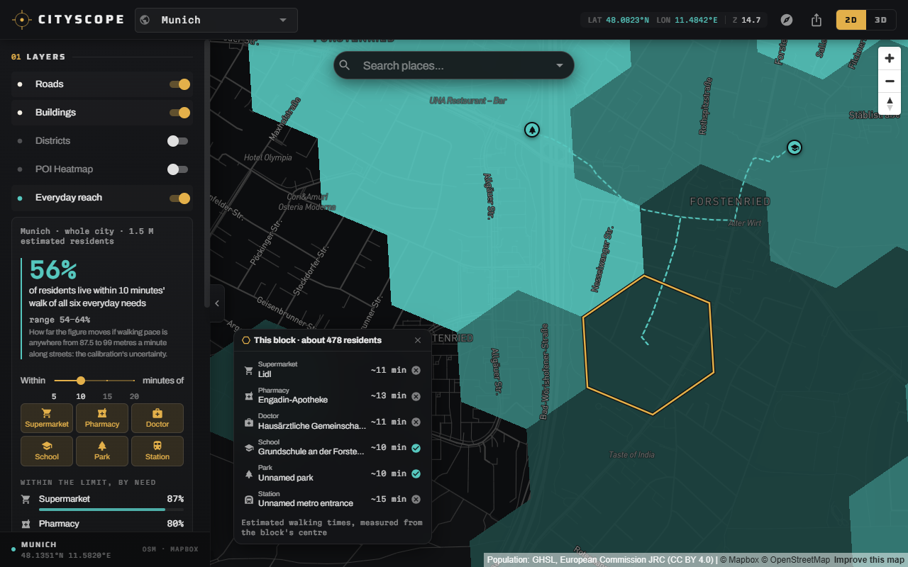
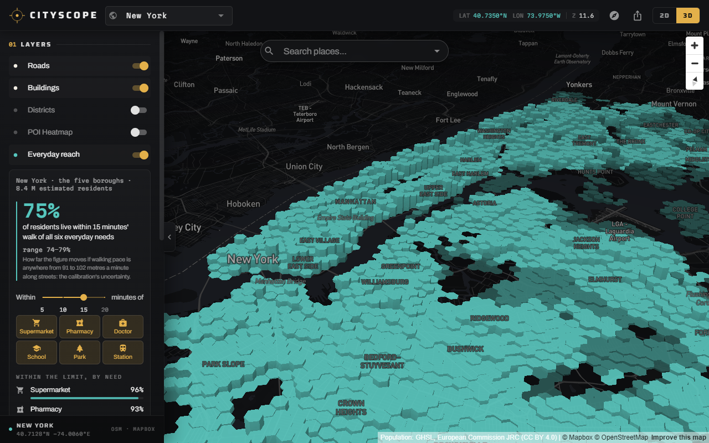

# CityScope

[](https://github.com/Marvinkwame/CityScope/actions/workflows/ci.yml)

**How close does every block of a city live to a supermarket, a pharmacy, a doctor, a school, a park and a station, walking its real streets?** CityScope answers that for eight cities from OpenStreetMap data, and checks its answers against Mapbox's own walking isochrones. Around it sits a set of map tools: live PostGIS statistics for districts and drawn areas, isochrones, routes, a POI heatmap and shareable links.

🔗 **[Live demo](https://city-scope-seven.vercel.app)** &nbsp;·&nbsp; [How Everyday reach works](docs/everyday-reach.md) &nbsp;·&nbsp; [Run it locally](#run-it-locally)



*Everyday reach in Munich at 10 minutes. Each block is shaded by how many of six everyday needs are within reach, and the selected block's walks to its nearest school and park follow the streets.*

---

## Everyday reach

- **What it shows.** 42,425 populated blocks (**H3** resolution-9 hexagons) across eight cities, each with its estimated residents and its walk to the nearest place for each of six needs: 254,550 walks in all. Pick a time limit (5–20 minutes) and the needs you care about; every block recolours, and the headline (the share of residents within reach of them all) is recalculated in the browser in one pass over **typed arrays**, with no server call. Click a block to see its walks.
- **How the walks are measured.** Along each city's OpenStreetMap streets and paths. The build runs one **multi-source Dijkstra** search per need, outward from all of its places at once, so London's 2.7-million-node network needs six searches, about a minute in all. Squares and quays mapped as outlines get straight crossings first, so walks cut across them.
- **How it's checked.** Each city's walking pace is fitted against Mapbox walking isochrones on 60 sample blocks and graded on a held-out half: **90–96% agreement at 5 minutes, 97–100% at 15**. The app shows each figure beside its base rate (what always answering "within" would score), because at 15 minutes that alone is high.
- **Where it's wrong.** The blocks it still gets most wrong, and why, are written up under [Where it breaks](docs/everyday-reach.md#where-it-breaks).

Share of residents with all six needs within 15 minutes' walk, and the range across each city's calibrated pace. **Not a ranking:** the cities cover very different areas, and OpenStreetMap is more complete in some than others.

| City | Covers | All six within 15 minutes | Range |
|---|---|---|---|
| Amsterdam | whole city | 75% | 73–76% |
| Berlin | whole city | 72% | 70–72% |
| London | all 33 boroughs | 69% | 67–75% |
| Munich | whole city | 84% | 82–88% |
| New York | the five boroughs | 76% | 75–79% |
| Paris | the 20 arrondissements | 99.6% | 99.6%–99.8% |
| Sydney | 33 inner suburbs | 95% | 94–97% |
| Tokyo | the 23 wards | 86% | 86–88% |



*New York in 3D at 15 minutes. Each block rises by its estimated residents: Manhattan's stand tallest, and the darker blocks in Queens are missing one need or more.*

## Also in the app

- **District statistics:** click a district for a live PostGIS query (`ST_Contains`, `ST_Area`): place count, density per km², top categories, and how it compares with the city.
- **Draw and analyse:** sketch any polygon; the backend counts the places inside with `ST_Within`.
- **Isochrones:** walking, cycling or driving reach in 5–30 minute bands, with the places in each band joined server-side.
- **Routes:** A to B with distance, duration and turn-by-turn steps.
- **Heatmap and spotlight:** a density heatmap of OpenStreetMap places; click anywhere for the nearest within 300 m (Turf.js, in the browser).
- **Search, layers, 3D and eight cities**, on desktop and phone.
- **Save and share:** the whole view, including the active tool and its inputs, lives in the URL hash, so any view is a link.

## Tech stack

**Frontend:** React 19 · TypeScript · Vite 8 · Mapbox GL JS 3 · `@mapbox/mapbox-gl-draw` · Turf.js · Material UI 7 · Zustand 5 · TanStack Query 5 · Vitest

**Backend:** Node.js · TypeScript · Express 5 · **PostgreSQL + PostGIS** (`pg`) · Vitest

**Data:** OpenStreetMap via the **Overpass API** · GHSL population grid · Mapbox Isochrone / Directions / Geocoding APIs

## Architecture highlights

- **PostGIS as a spatial engine, not just a store.** Places carry a generated `geometry(Point,4326)` column with a **GiST index**, and district and drawn-area analysis run as indexed server-side queries rather than shipping every point to the browser. Schema changes ship as idempotent SQL migrations.
- **Compute ahead, serve one payload.** Everyday reach is built offline, city by city, and stored as one Brotli-compressed payload with an `ETag` (8 KB for Sydney, about 590 KB for London). The browser does all the recolouring; a separate endpoint serves one block's walks when it is clicked.
- **Data releases are checked, not trusted.** Every script that writes refuses to run without a target label and prints the database host first, and each production rebuild so far has been compared block for block with the same build made locally.
- **All map mutations in one component.** Every Mapbox source, layer and marker lives in `MapView.tsx` and reacts to Zustand stores; event handlers read stores with `getState()` to avoid stale closures inside Mapbox's event system.
- **Design tokens enforced by a test.** Every colour plays one of three roles (*you*, *answer*, *context*), defined once in `theme.ts`; a test fails on any colour literal elsewhere.

## Run it locally

You need Node.js 20.19+ or 22.12+, PostgreSQL **with PostGIS** (local, or a managed provider such as Neon) with `psql`, and a [Mapbox access token](https://account.mapbox.com/access-tokens/).

**Backend**

```bash
cd cityscope-backend
npm install
cp .env.example .env          # set DATABASE_URL, PORT=3001, CORS_ORIGIN (and CITYSCOPE_DB_TARGET=local if DATABASE_URL is a local database)

# schema, once, on an empty database
psql -c "CREATE DATABASE cityscope;"
psql -d cityscope -f src/scripts/setup-db.sql          # PostGIS + the cities, districts and pois tables
npm run migrate -- 001-add-cities.sql
npm run migrate -- 002-add-poi-geometry.sql           # geom column + GiST indexes
npm run migrate -- 003-repair-district-outlines.sql

# data
npm run seed:all              # cities, districts and places from the committed files

npm run dev                   # http://localhost:3001
```

Scripts that write to a database refuse to run unless `CITYSCOPE_DB_TARGET` holds a label (such as `local`), and print it with the database host before connecting. Building Everyday reach for a city is optional and takes a few more steps: see [Building the data](docs/everyday-reach.md#building-the-data).

**Frontend**

```bash
cd cityscope
npm install
cp .env.example .env.local    # set VITE_MAPBOX_TOKEN and VITE_API_URL=http://localhost:3001
npm run dev                   # http://localhost:5173
```

**Tests:** `npm test` in either folder (Vitest). GitHub Actions ([`ci.yml`](.github/workflows/ci.yml)) runs lint, tests and a production build for the frontend, and a build, a type-check of the scripts and tests for the backend, on every pull request and every push to `main`.

## API

City-scoped routes (`:cityId`, e.g. `berlin`):

| Method | Endpoint | Description |
|--------|----------|-------------|
| GET  | `/api/cities` | All available cities |
| GET  | `/api/cities/:cityId/districts` | District boundaries (GeoJSON) |
| GET  | `/api/cities/:cityId/districts/:id/stats` | Live district statistics (PostGIS) |
| GET  | `/api/cities/:cityId/pois` | A city's places, for the heatmap and the 300 m spotlight |
| POST | `/api/cities/:cityId/pois/within` | Count places inside a drawn polygon (`ST_Within`) |
| POST | `/api/cities/:cityId/pois/in-isochrone` | The places inside each band of an isochrone, joined server-side |
| GET  | `/api/cities/:cityId/reach` | Everyday reach for a whole city: every populated block with its residents and its walk to the nearest of each need. Brotli when accepted, `ETag` / `304`; `404` until the city is published |
| GET  | `/api/cities/:cityId/reach/:cellId` | One block's nearest places, with each walk along the streets as `[lng, lat]` pairs |
| GET  | `/health` | Keep-warm target; never touches the database |

## Deployment

Frontend on **Vercel** → API on **Render** → **Neon** Postgres + PostGIS. Render's free tier sleeps after 15 minutes without traffic, so an external scheduler calls `/health` every 10 minutes to keep the API awake; if a ping is missed, the app says the server is waking up instead of showing a blank map.

## Data and licences

The code is MIT ([LICENSE](LICENSE)). Place and park data © [OpenStreetMap contributors](https://www.openstreetmap.org/copyright) under the [ODbL](https://opendatacommons.org/licenses/odbl/), including the committed `cityscope-backend/src/scripts/pois-data*.json` files, which are ODbL, not MIT. Population data: GHSL GHS-POP R2023A, European Commission JRC, [CC BY 4.0](https://creativecommons.org/licenses/by/4.0/). What the data covers, and where it falls short, is in [the Everyday reach notes](docs/everyday-reach.md#the-place-data).
