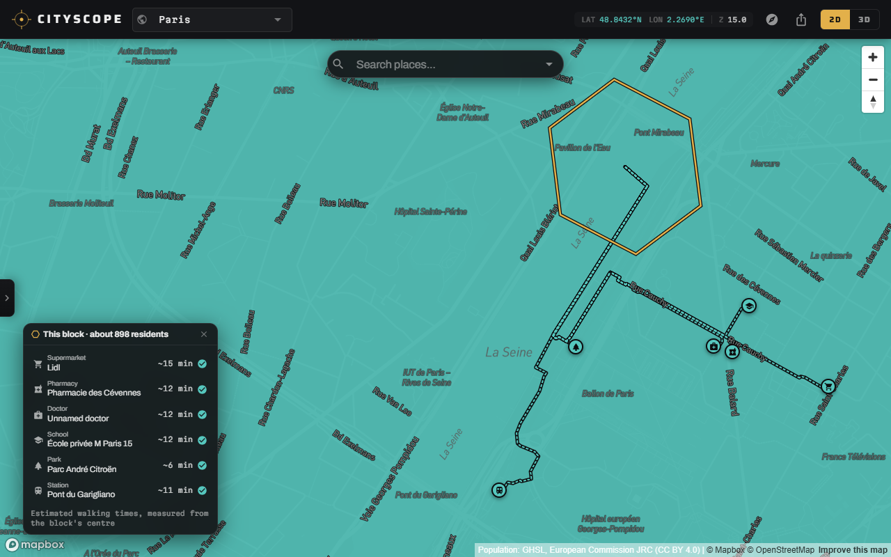
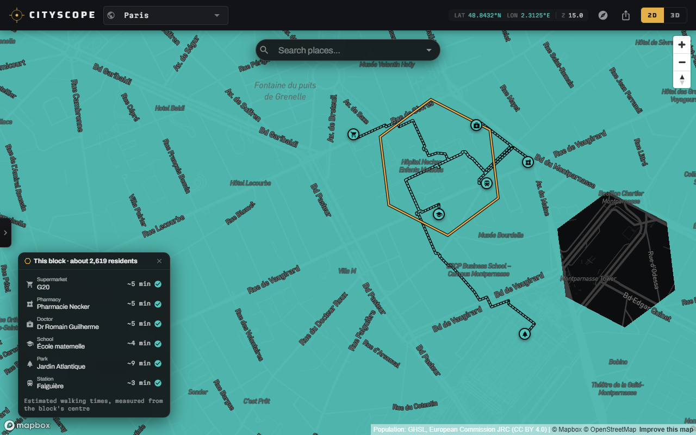

# Everyday reach: how it works and how well it holds up

Everyday reach asks how close the people of a city live to six everyday needs: a supermarket, a pharmacy, a doctor, a school, a park and a station. It answers block by block, with a walking time from the middle of each populated block to the nearest place for each need, for eight cities: Amsterdam, Berlin, London, Munich, New York, Paris, Sydney and Tokyo.

This page holds the method, the measured results and the known failures. The [README](../README.md) has the short version.

- [How a walk is measured](#how-a-walk-is-measured)
- [How well it agrees with Mapbox](#how-well-it-agrees-with-mapbox)
- [Where it breaks](#where-it-breaks)
- [Building the data](#building-the-data)
- [The two endpoints](#the-two-endpoints)
- [The place data](#the-place-data)
- [History](#history)
- [Sources and licences](#sources-and-licences)

## How a walk is measured

**Residents and walking times in Everyday reach are estimates.** Residents come from the GHSL population grid (2025 epoch, 3-arcsecond tiles), a modelled grid rather than a census, added up into H3 resolution-9 hexagons. A walk is measured along OpenStreetMap's walkable streets and paths: from the block's centre to its nearest street node, through the network, and on to the place (a park from the nearest of its entry points, one every 25 m along its edge). It is timed at a per-city pace fitted against Mapbox walking isochrones (5, 10, 15 and 20 minutes) on a sample of 60 blocks per city. A time limit passes for a city only if the walking times agree with Mapbox on at least 80% of a held-out half of that sample, and the payload records which ones passed. Measured on 2026-11-27, **every one of the eight cities passed at all four time limits**. Agreement on the held-out half ran from 90.0% (Sydney, 5 minutes) to 100% (four cities at 20 minutes), and at 15 minutes from 96.7% (New York) to 100% (London and Sydney). The 5-minute limit has the lowest agreement in every city. The fitted paces are between 90 (Munich and Tokyo) and 95.5 (Amsterdam) metres of street a minute, about 5.4–5.7 km/h; that eight cities agree so closely suggests the pace is mostly Mapbox's own walking speed rather than anything about the cities. Agreement is graded at the pace fitted on the other half of the sample, while the published pace is refitted on all 60 blocks, so the figures describe a slightly different fit from the one the map uses.

**One search per need, not one per block.** Instead of routing from each block, the build runs a **multi-source Dijkstra** outward from all of a need's places at once over the city's walking graph (stored in typed arrays, compressed-sparse-row), so one search labels every street node with its nearest place and the path back to it: London's 15,838 blocks × 6 needs come from six searches over 2.7 million nodes in about a minute. Ties break by a fixed place order, so a rebuild from the same data gives the same answer.

**Paved areas are crossed, not walked round.** Squares and paved quays that the map draws as outlines (`area=yes`) get straight crossings before the graph is built: from each point on the outline to every entrance (an outline point another way also uses) that a straight line inside the area can reach. Footpaths tagged `foot=private` are left out, like `foot=no`.

**One rule for "within".** A place is within T minutes when its walk is at most `T × k` metres, where `k` is the city's fitted pace. The block colours, the headline and the block card all use it.

## How well it agrees with Mapbox

**Read the agreement against the base rate:** how often the nearest place is within the limit at all, which is what always answering "within" would score. At 5 minutes that is 44–61% (Paris 78%), so the 90–96% agreement is real information. At 15 and 20 minutes it is 87–100%, and in the dense cities the walking times barely beat it: at 15 and 20 minutes they equal it in Paris (99.4% and 100%), and always answering "within" would itself clear the 80% bar at 15 minutes in every city. The 5-minute limit is therefore the informative one. Each payload carries its base rates beside its agreement, and the app's method note shows each time limit's agreement next to what always answering "within" would score.

**Each city's headline**, measured on 2026-11-27 from the street build with paved areas crossed, with the app's own rule: the share of estimated residents whose block has all six needs within 15 minutes' walk at the city's published pace (`metres ≤ 15 × k`), and the range from the slow to the fast end of its calibrated pace. **This is not a ranking.** The cities cover very different areas, from Sydney's 33 inner suburbs (26.5 km²) to London's 33 boroughs (1,595 km²), and OpenStreetMap is more complete in some than in others.

| City | Covers | All six needs within 15 minutes | Range |
|---|---|---|---|
| Amsterdam | whole city | 75% | 73–76% |
| Berlin | whole city | 72% | 70–72% |
| London | all 33 boroughs | 69% | 67–75% |
| Munich | whole city | 84% | 82–88% |
| New York | the five boroughs | 76% | 75–79% |
| Paris | the 20 arrondissements | 99.6% | 99.6%–99.8% |
| Sydney | 33 inner suburbs | 95% | 94–97% |
| Tokyo | the 23 wards | 86% | 86–88% |

**Straight line vs street.** Until 2026-11-21 a walk was the straight-line distance at a fitted pace, so one pace per city had to stand in for every detour. Measured the same way on the same blocks (the straight line from the production payloads of 2026-11-06):

| City | Agreement at 5 minutes | Agreement at 15 minutes | Headline, 15 minutes | Residents whose block changes colour at 15 minutes |
|---|---|---|---|---|
| Amsterdam | 93.3% → 95.6% | 98.9% → 97.8% | 74% → 75% | 5.3% |
| Berlin | 87.8% → 94.4% | 94.4% → 98.9% | 67% → 72% | 11.8% |
| London | 91.7% → 92.2% | 97.2% → 100% | 69% → 69% | 11.2% |
| Munich | 91.7% → 93.3% | 97.8% → 98.9% | 81% → 84% | 8.4% |
| New York | 90.6% → 95.6% | 95.6% → 96.7% | 73% → 75% | 7.6% |
| Paris | 91.1% → 95.6% | 99.4% → 99.4% | 99% → 99.6% | 0.5% |
| Sydney | 91.7% → 90.0% | 99.4% → 100% | 93% → 95% | 4.0% |
| Tokyo | 85.0% → 92.8% | 97.8% → 99.4% | 81% → 86% | 7.5% |

Walking along the streets agrees better with Mapbox at 5 minutes in seven of the eight cities, most in Tokyo (+7.8 points) and Berlin (+6.6), and narrows every city's range, because the pace no longer has to absorb each street's detour: the median walk is 1.28–1.55 times the straight line, longest to schools in every city. Sydney is the exception at 5 minutes, 18 of its 180 checks wrong by street against 15 by straight line, a difference within chance; its extra misses are places 185–418 m away in a straight line (463–605 m by street) whose walks come out just over the limit while Mapbox's area still covers them. It is measured by street like the others. At the longer limits agreement falls in four places, each by 1–3 of 180 checks: Amsterdam at 15 minutes (98.9% to 97.8%), Munich at 20 (99.4% to 98.9%), New York at 20 (99.4% to 98.9%) and Paris at 10 (99.4% to 97.8%). The cost is small: each payload grows by at most 1.4% compressed, a block card from about 0.8 KB to about 2 KB (9.4 KB for the Berlin block with the most walk points), and the walks add 78 MB to the database.

**Crossing paved areas** (2026-11-27). Each city's streets were downloaded again as the map stood on 2026-11-21, so the only differences from the street build above are the crossings and the private footpaths: 443–6,596 walkable areas a city (Paris has by far the most) and 15–798 `foot=private` ways left out. Held-out agreement is unchanged at every limit in every city except Paris at 5 minutes, one check better (95.6% to 96.1%). About a third of Paris's walks get shorter, typically by 7 m and by up to 452 m, and 2.7% of its residents' blocks change colour at 5 minutes; elsewhere 2–9% of walks get shorter and at most 0.3% of residents see a colour change. Headlines move by less than 0.1 point. Adding the crossings takes at most 7.3 s of a city's build (Paris), and the payloads stay within 0.6% of their size.

## Where it breaks

Checks are counted as the calibration counts them: 24 per held-out block (six needs at four limits), graded at the pace fitted on the other half of the sample. Each link opens the block and its card at the limit where it went most wrong.

The three blocks the straight line got most wrong in the 2026-11-06 calibration are mostly right by street. Tokyo's goes from 7 wrong to none, Munich's from 5 to 1, and Berlin's, beside Schlosspark Charlottenburg, from 5 to 2: the straight line counted the park, 380 m away, as within 10 and 15 minutes, though Mapbox's walks didn't reach it until 20; by street the nearest park is Klausenerplatz, 1.5 km away, and both checks come out right. What the straight line got wrong at each:

- **Tokyo**, block `892f5aadb8fffff` (35.67383, 139.71863): 7 of 24 wrong by straight line, 0 by street. The estimate counted a school and a metro entrance about 280 and 300 m away as within 5 minutes, and the supermarket (about 490 m), the school and Meiji Park (about 370 m to its edge) as within 10; Mapbox's walks reached none of them in time. Mapbox did reach a doctor and a pharmacy about 330 m away within 5 minutes, which the estimate put just over. [Open at 5 minutes](https://city-scope-seven.vercel.app/#s=eyJ2IjoxLCJjaXR5IjoidG9reW8iLCJ2aWV3Ijp7ImxuZyI6MTM5LjcxODYzLCJsYXQiOjM1LjY3MzgzLCJ6b29tIjoxNSwiYmVhcmluZyI6MCwicGl0Y2giOjB9LCJsYXllcnMiOnsicm9hZHMiOnRydWUsImJ1aWxkaW5ncyI6dHJ1ZSwiZGlzdHJpY3RzIjpmYWxzZSwiaGVhdG1hcCI6ZmFsc2V9LCJpczNEIjpmYWxzZSwicmVhY2giOnsidCI6NSwibiI6WyJzbSIsInBoIiwiZHIiLCJzYyIsInBrIiwic3QiXSwiYyI6Ijg5MmY1YWFkYjhmZmZmZiJ9fQ)
- **Munich**, block `891f8d4e977ffff` (48.08126, 11.49144): 5 of 24 wrong by straight line, 1 by street. The estimate counted the supermarket (about 470 m), the park (about 440 m to its edge) and the school (about 620 m) as within 10 minutes, and Mapbox reached none of them in time; Mapbox reached the doctor (about 750 m) within 10 minutes and a metro entrance (about 1 km) within 15, which the estimate put just outside. [Open at 10 minutes](https://city-scope-seven.vercel.app/#s=eyJ2IjoxLCJjaXR5IjoibXVuaWNoIiwidmlldyI6eyJsbmciOjExLjQ5MTQ0LCJsYXQiOjQ4LjA4MTI2LCJ6b29tIjoxNSwiYmVhcmluZyI6MCwicGl0Y2giOjB9LCJsYXllcnMiOnsicm9hZHMiOnRydWUsImJ1aWxkaW5ncyI6dHJ1ZSwiZGlzdHJpY3RzIjpmYWxzZSwiaGVhdG1hcCI6ZmFsc2V9LCJpczNEIjpmYWxzZSwicmVhY2giOnsidCI6MTAsIm4iOlsic20iLCJwaCIsImRyIiwic2MiLCJwayIsInN0Il0sImMiOiI4OTFmOGQ0ZTk3N2ZmZmYifX0)
- **Berlin**, block `891f1d482b7ffff` (52.52519, 13.27961): 5 of 24 wrong by straight line, 2 by street. The estimate counted Schlosspark Charlottenburg (about 380 m to its edge) as within 10 and 15 minutes, and a school about 860 m away as within 15 and 20; Mapbox reached the park only within 20 minutes, and the school not even then. Mapbox reached Westend station (about 860 m) within 15 minutes, which the estimate put a few metres outside. [Open at 15 minutes](https://city-scope-seven.vercel.app/#s=eyJ2IjoxLCJjaXR5IjoiYmVybGluIiwidmlldyI6eyJsbmciOjEzLjI3OTYxLCJsYXQiOjUyLjUyNTE5LCJ6b29tIjoxNSwiYmVhcmluZyI6MCwicGl0Y2giOjB9LCJsYXllcnMiOnsicm9hZHMiOnRydWUsImJ1aWxkaW5ncyI6dHJ1ZSwiZGlzdHJpY3RzIjpmYWxzZSwiaGVhdG1hcCI6ZmFsc2V9LCJpczNEIjpmYWxzZSwicmVhY2giOnsidCI6MTUsIm4iOlsic20iLCJwaCIsImRyIiwic2MiLCJwayIsInN0Il0sImMiOiI4OTFmMWQ0ODJiN2ZmZmYifX0)

By street, no held-out block has more than 3 of its 24 checks wrong, and ten blocks in six cities have 3. Two in Paris show where walking the map's streets still breaks:

- **Paris**, block `891fb46296fffff` (48.84586, 2.27454): 3 of 24 wrong. The block's nearest walkable point, 66 m from its centre, is on a cobbled lower quay beside the Seine, mapped as a paved area (`highway=pedestrian`, `area=yes`). Walks now cross such areas in a straight line, but on OpenStreetMap this quay has no stairs or ramp at its north end: its only mapped way off is at its south end. So every walk from the block runs about 380 m along the quay before meeting a street, and the nearest doctor, pharmacy and school come out at about 1 km (11–12 minutes), though the closest of each is 200–380 m away in a straight line. Mapbox reached them within 10 minutes. Crossing the quay instead of following its edge saved only about 20 m; the detour comes from joining the block to its single nearest point, which here is on the quay. Joining to the best point within 50–150 m instead was measured, and agreed less with Mapbox in Paris, Berlin and London. [Open at 10 minutes](https://city-scope-seven.vercel.app/#s=eyJ2IjoxLCJjaXR5IjoicGFyaXMiLCJ2aWV3Ijp7ImxuZyI6Mi4yNzQ1NCwibGF0Ijo0OC44NDU4Niwiem9vbSI6MTUsImJlYXJpbmciOjAsInBpdGNoIjowfSwibGF5ZXJzIjp7InJvYWRzIjp0cnVlLCJidWlsZGluZ3MiOnRydWUsImRpc3RyaWN0cyI6ZmFsc2UsImhlYXRtYXAiOmZhbHNlfSwiaXMzRCI6ZmFsc2UsInJlYWNoIjp7InQiOjEwLCJuIjpbInNtIiwicGgiLCJkciIsInNjIiwicGsiLCJzdCJdLCJjIjoiODkxZmI0NjI5NmZmZmZmIn19)

  
- **Paris**, block `891fb46708fffff` (48.84489, 2.31610): 3 of 24 wrong. Its nearest park by street is Jardin Atlantique, the garden built over the tracks of Gare Montparnasse. The walk reaches it along a footway mapped on the garden's level (806 m, under 9 minutes); Mapbox's walks didn't reach it even within 15. One of the two networks has the way up wrong, and this data can't say which. [Open at 10 minutes](https://city-scope-seven.vercel.app/#s=eyJ2IjoxLCJjaXR5IjoicGFyaXMiLCJ2aWV3Ijp7ImxuZyI6Mi4zMTYxLCJsYXQiOjQ4Ljg0NDg5LCJ6b29tIjoxNSwiYmVhcmluZyI6MCwicGl0Y2giOjB9LCJsYXllcnMiOnsicm9hZHMiOnRydWUsImJ1aWxkaW5ncyI6dHJ1ZSwiZGlzdHJpY3RzIjpmYWxzZSwiaGVhdG1hcCI6ZmFsc2V9LCJpczNEIjpmYWxzZSwicmVhY2giOnsidCI6MTAsIm4iOlsic20iLCJwaCIsImRyIiwic2MiLCJwayIsInN0Il0sImMiOiI4OTFmYjQ2NzA4ZmZmZmYifX0)

  

**Blocks far from any street.** A block's walk starts at its nearest street node, and the join counts as walking. In seven cities under 0.5% of residents live in blocks more than 150 m from one. Amsterdam has 3.5%, most of them in the Westpoort port, where GHSL's modelled grid puts about 27,600 residents on industrial land with no public streets to walk.

**London's doctors were checked against the NHS list of GP practices.** Of the 1,142 practices inside London's outline, 70.7% have an OpenStreetMap doctor or clinic within 150 m (median distance 57 m), so about three in ten do not. The test is strict, because a postcode places a practice only roughly, but it does mean OSM's London doctors may be incomplete or tagged differently, and London's distances to a doctor may be overstated.

## Building the data

The two `/reach` endpoints serve data built ahead of time, one city at a time. For each populated block (an H3 hexagon at resolution 9) it holds the estimated residents and the walking distance along the streets to the nearest supermarket, pharmacy, doctor, school, park and station, and for the block card each walk's line. To build a city, after the main setup in the README and with `CITYSCOPE_DB_TARGET` set (below). The repo ships pre-fetched `pois-data-*.json` for all cities, so the `fetch:pois` step is only needed to refresh a city from OpenStreetMap.

```bash
npm run migrate -- 004-everyday-reach.sql   # once: reach tables + a geography index on pois
npm run migrate -- 005-reach-walks.sql      # once: the walk line on each nearest place
npm run fetch:pois    -- berlin     # places, 19 categories, over the city's fetch box
npm run fetch:parks   -- berlin     # parks as shapes -> data/parks-berlin.json
npm run fetch:streets -- berlin     # the walkable streets and paths -> data/streets-berlin.json
npm run seed:pois     -- berlin     # replace the city's places
npm run seed:parks    -- berlin     # replace the city's parks
npm run reach:build   -- berlin     # cells, residents, nearest place per need along the streets
npm run reach:calibrate -- berlin   # fit the walking pace against Mapbox
npm run reach:check-gp              # London only, optional: compare its doctors with NHS GP practices
npm run reach:publish -- berlin     # compress the result into the one payload the API serves
npm run reach:compare -- berlin     # optional, read-only: the city before and after a rebuild
```

- `fetch:pois` and `fetch:parks` also record when they ran and the OSM database time Overpass answered from, beside the file they wrote: `src/scripts/pois-data-<city>.source.json` (committed) and `data/parks-<city>.source.json` (git-ignored). `reach:publish` copies these, and the calibration time, into the payload's `meta.sources`. The files fetched on 2026-10-20 carry only that date, with the OSM time unknown (`null`).
- `reach:build` reads GHSL population tiles from `cityscope-backend/data/ghsl/` (or `--ghsl <dir>`). Download the 2025 epoch, 3-arcsecond, WGS84 tiles of GHS-POP R2023A (`GHS_POP_E2025_GLOBE_R2023A_4326_3ss`) that cover the city and unzip the `.tif` files there. `data/` is git-ignored.
- `fetch:streets` asks Overpass for every walkable way (footways, paths, steps, residential and service streets, up to primary and trunk roads; `foot=no` and `foot=private` always left out, other private access unless `foot` allows it) over the city's fetch box, in 0.1° tiles (`--tile <degrees>` to change), and saves the nodes and ways compactly to `cityscope-backend/data/streets-<city>.json` with a `.source.json` beside it (both git-ignored; Berlin's is about 53 MB, London's 88 MB). The file also lists the walkable areas: closed ways tagged `area=yes`, such as squares and paved quays. `--date <ISO time>` downloads the map as it was at that time, which is how a rebuild can change one thing and keep the rest of the map fixed.
- `reach:build` measures along those streets by default (`--method network`). It first adds straight crossings inside each walkable area, from every outline point to every entrance (an outline point another way also uses) that a straight line inside the area can reach; an area with more than 1,000 outline points gets none, and the build prints how many were skipped. It then keeps the network's largest connected part, joins each block's centre and each place to its nearest street node (a park to entry points every 25 m along its edge), and searches outward from every place of a need at once. A walk's metres are the block's join, the network distance and the place's join; its line, simplified to 2 m, is stored for the block card. `--method estimate` builds the earlier straight-line version instead.
- `npm run reach:build -- berlin --dry-run` counts the city's residents in a read-only session and writes nothing. With the network default it also loads the street graph, joins the blocks and runs the six searches, printing the join distances and detours as a real run would, still writing nothing (`--method estimate` stops after the resident counts).
- `reach:calibrate` asks Mapbox for the walking isochrones of 60 sampled blocks per city and needs `MAPBOX_TOKEN` in `.env`: a token used only by scripts, never the frontend's public one. Each answer is cached in `cityscope-backend/data/isochrones/<city>/<h3>.json` (git-ignored) and reused for the same request, so a rerun on the same blocks makes no requests and needs no token. It prints, and stores in `reach_calibration.checks` as `calibrationBaseline`, each band's base rate beside its agreement.
- `reach:check-gp` is for London only and takes no city. It reads NHS England's GP practice list (the ODS `epraccur` file, saved as `cityscope-backend/data/nhs/epraccur.csv`, git-ignored), looks each practice's postcode up on postcodes.io, and stores the share of London's practices that have an OSM doctor or clinic within 150 m. It needs London built and calibrated, and `reach:publish -- london` afterwards puts the result into the payload.
- **Rebuild after every place reload.** `reach_nearest` stores place ids, and reloading places (`seed:pois`, `seed:parks`, or `seed:all`, which reloads every city's places and districts) gives every place a new id. So the reload deletes that city's reach cells, nearest places, calibration and payload in the same transaction, and says so: a stale block card or payload can never be served, and the city's `/reach` endpoints answer 404 until it is rebuilt. After a reload, run `reach:build`, `reach:calibrate` and `reach:publish` again for each city reloaded, and for London `reach:check-gp` between calibrate and publish (a rebuild clears its result). `reach:build` clears the city's calibration and payload, and `reach:calibrate` clears its payload, so `GET /reach` answers 404 until `reach:publish` has run again, and the block card (`/reach/:cellId`) answers 404 until `reach:calibrate` has run. A new street file (`fetch:streets`) changes the walks too, so after one run `reach:build`, `reach:calibrate` and `reach:publish` again for that city.
- `reach:compare` prints one table row comparing a city before and after a rebuild: the headline with its range, the 15-minute agreement and base rate, and the share of residents whose block changes colour. "Before" is a saved payload in `data/reach-before/<city>.json` (git-ignored), or any payload file given with `--before <file>`; "after" is the published payload, read in a read-only transaction.

**`CITYSCOPE_DB_TARGET`.** The scripts that write to a database (`migrate`, `seed`, `seed:cities`, `seed:pois`, `seed:parks`, `seed:all`, `reach:build`, `reach:calibrate`, `reach:publish`, `reach:check-gp`) refuse to run unless this holds a non-empty label of your choosing (`local`, `reach-dev`, `production`), and they print it with the database host before connecting, as `Writing to local (localhost:5432)`. The label is only what you typed: nothing checks it against `DATABASE_URL`, so the printed host is the part to read. For a local database, `CITYSCOPE_DB_TARGET=local` can stay in `.env`, as long as that file's `DATABASE_URL` really is a local database. For any other target, set it on the command line for that run (`CITYSCOPE_DB_TARGET=production npm run ...`) and keep it out of `.env`. `reach:build --dry-run` writes nothing and doesn't need it.

## The two endpoints

| Method | Endpoint | Description |
|--------|----------|-------------|
| GET  | `/api/cities/:cityId/reach` | Everyday reach for a whole city: one precomputed GeoJSON of populated H3 blocks with their estimated residents and walking distance to the nearest of six everyday needs, and how it was measured (`meta.method`: `network` or `estimate`). Brotli-compressed when the client accepts it, with an `ETag` (`304` when unchanged); `404` until the city has been published |
| GET  | `/api/cities/:cityId/reach/:cellId` | One block's residents and, for each need, its nearest place (name, category, coordinates, metres, estimated minutes rounded up, so they agree with the map's colour) and the walk there along the streets as `[lng, lat]` pairs (`null` for a straight-line build). `400` for a malformed cell id, `404` for an unknown cell |

The Everyday reach map layer reads these two endpoints: the city's payload the first time the layer is switched on, and a block's card when that block is selected.

## The place data

POIs are real OpenStreetMap data fetched via Overpass for a fixed set of **19 categories**: the original 11 (food & drink, culture, leisure, retail) plus the everyday needs (pharmacies, doctors and clinics, schools, rail stations and halts, tram stops and metro entrances). Two of the 19, tram stops and metro entrances, only measure the station need in Everyday reach; place lists, district statistics and drawn-area results leave them out, and the heatmap still draws only the original 11. Counts are complete **for those categories within each city's fetch box**: the extent of its district outline plus 2 km on every side (never smaller than the city's earlier bounds), so places just across the boundary count for the blocks beside it. It is not every POI type, and the box is a rectangle rather than an exact administrative boundary.

Both point features and area features are included; an area such as a park or a museum building is represented by its centre point, so a distance to a large park is measured to its middle, not its nearest edge. Everyday reach treats parks differently: they are also stored as shapes (a `parks` table, with multipolygon relations assembled by `osmtogeojson`), and the park need counts only parks of at least 0.5 ha (5,000 m²), measured to the nearest edge. Categories match exact OSM tag values (so `amenity=pub` counts, `amenity=public_bookcase` does not). Some places are mapped twice in OSM itself: 665 of the 232,620 displayed places (0.29%) share their category and name with another place less than 25 m away (measured on the 2026-10-20 data; unnamed places are not counted). They are kept rather than merged by a distance heuristic, which would also merge genuine neighbouring chain outlets.

## History

- **2026-11-06:** live with straight-line distances at a fitted pace.
- **2026-11-24 and 2026-11-26:** measured along the streets (Sydney first, then the other seven), each city matching the local build block for block; each city's map was unavailable for 18–51 seconds during its switch.
- **2026-11-28:** walks cross paved areas and skip `foot=private` paths, again matching the local build block for block, with 17–51 seconds of unavailability per city.

## Sources and licences

Place and park data © [OpenStreetMap contributors](https://www.openstreetmap.org/copyright), available under the [Open Database License (ODbL)](https://opendatacommons.org/licenses/odbl/). The committed place files (`cityscope-backend/src/scripts/pois-data*.json`) are ODbL, not MIT.

Population data: Schiavina, Freire, Carioli, MacManus (2023), *GHS-POP R2023A*, European Commission, Joint Research Centre (JRC), doi:[10.2905/2FF68A52-5B5B-4A22-8F40-C41DA8332CFE](https://doi.org/10.2905/2FF68A52-5B5B-4A22-8F40-C41DA8332CFE), licensed [CC BY 4.0](https://creativecommons.org/licenses/by/4.0/).
